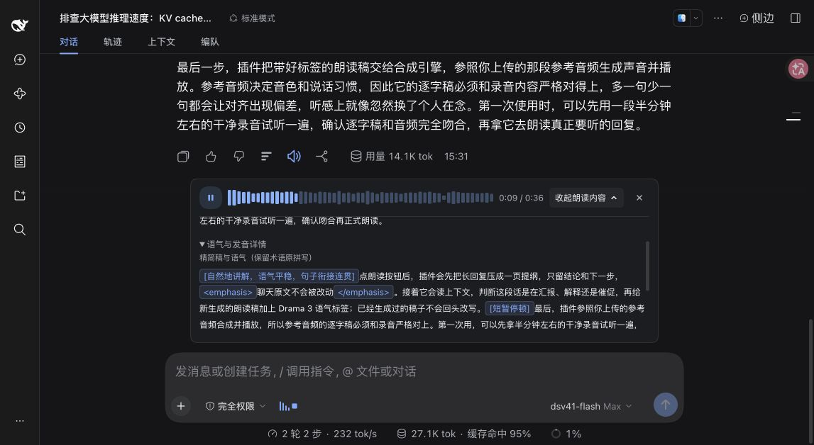

# dsh-drama3-tts

[English](README.md) | **简体中文**

把 DSH 助手回复整理成适合听的口播稿，再用 Drama 3 和参考录音生成语音。聊天原文保持完整，朗读稿可单独查看。

处理流程：**清洗与精简 → 可选语气编排 → 术语读法 → 整段或分段合成 → 播放**。语音识别只用于可选的中文句首检查，默认关闭，不是正常朗读的必要依赖。

## Demo 演示

[](examples/demo/demo.mp4)

[观看 DSH 实际使用录屏](examples/demo/demo.mp4) · [直接试听](examples/demo/audio.mp3)

录屏从 DSH 聊天界面开始：点击助手回复旁的朗读按钮，在播放时展开「查看朗读内容」和「语气与发音详情」，查看自动生成的精简稿和语气标签，直至播放完成、播放器自动收起。合成使用本地 Drama 3、嘉岚 3.5 参考音色和 1.2 倍语速；录屏界面和语音均为中文。

视频配音就是插件本次实际播放的音频，按原始速度播放。视频和单独的音频样例均可离线观看、试听。

## 开始使用

需要 Node.js 22 或更高版本，以及 `>=0.2.1-rc.2 <0.3.0` 的 DSH。

1. 在 DSH 插件页添加本地项目目录：`link:/absolute/path/dsh-drama3-tts`，启用插件并刷新页面。
2. 打开「设置 → 语音朗读」，选择本地服务，填写服务地址及 `/v1/models` 返回的模型 ID。
3. 选择或上传参考录音，填写录音的准确逐字稿。可直接使用下方的[示例参考音频](#示例参考音频)。控制标签不属于实际台词，不要写进参考逐字稿。
4. 开启「精简回复」时配置文本处理服务。「语气与句级韵律」可独立关闭；「专业术语读法」和「短回复整段连贯合成」默认开启。
5. 在试听区先生成口播稿，确认内容与读法，再点「保存并试听」。按钮名称随精简、语气开关变化。
6. 点击回复旁的朗读按钮，或启用输入框旁的自动朗读。

本地模式需要支持 `ref_audio`、`ref_text` 的 Drama 3 服务，仅提供标准 OpenAI TTS 接口的服务不一定兼容。Fish Audio 云端作为可选提供方，需要单独配置 API Key 与音色 ID。

## 示例参考音频

教程提供一段用于本地 Drama 3 的 **嘉岚 3.5** 参考录音：20 秒、单声道 WAV。可以直接使用，也可以换成自己的录音。

- [参考音频 — jialan-3.5-20s.wav](examples/reference-audio/jialan-3.5-20s.wav)
- [配套逐字稿 — jialan-3.5-20s.txt](examples/reference-audio/jialan-3.5-20s.txt)

下载 WAV，或直接使用本地项目中的文件。在「设置 → 语音朗读」选择本地服务，点击「上传音频」并选中该文件。将下面的中文原样粘贴到「参考文本」，不要翻译或添加语气标签，然后点击「保存并试听」：

```text
到这儿我得说实话：再往下说，我就要开始复读自己了。第五个“继续”之后，剩下的选择基本是讲个冷笑话、装作有灵感，或者干脆承认没词了。我选后者。但也不是完全没得聊。
```

## 使用行为

- 短回复尽量整段合成；长回复按自然标点分段，并在播放当前段时预取下一段。
- 播放器放在当前会话输入框上方，支持暂停、继续、定位和停止；播放完成后自动收起。
- 展开「查看朗读内容」可核对口播稿、处理提示、原文及实际合成文本，并下载已生成音频。
- 同一页面、同一会话中的一条回复只自动尝试一次。失败、停止或重新挂载后，不会自动从头重播；手动朗读仍可重试。
- 摘要校验失败时最多修正一次，仍失败则朗读清洗后的原回复。修正不会放宽数值与技术标识检查。

## 文档

所有文档均提供中英文版本，可通过各页顶部的链接切换语言。

| 文档 | 内容 |
| --- | --- |
| [配置说明](docs/configuration.zh-CN.md) | 服务分工、代码默认值、参考录音、术语与可选识别检查 |
| [开发与 API](docs/development.zh-CN.md) | 模块边界、处理流程、HTTP 接口、测试及打包 |

## 开发验证

```sh
npm ci
npm run check
npm test
```

默认测试使用临时配置目录和模拟上游，不修改个人设置，也不需要运行模型。真实合成测试须显式开启，见[开发与 API](docs/development.zh-CN.md#验证)。

参考资料：[Drama 3 标签](https://docs.fish.audio/features/text-to-speech/drama-3)、[参考录音建议](https://docs.fish.audio/developer-guide/best-practices/voice-cloning)、[Fish 嘉岚 3.0 预设](https://fish.audio/zh-CN/m/fbe02f8306fc4d3d915e9871722a39d5/)。
