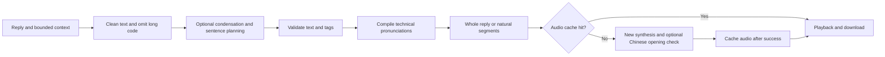

# Development and API

**English** | [简体中文](development.zh-CN.md)

[Back to README](../README.md) · [Configuration](configuration.md)

## Module boundaries

| File | Responsibility |
| --- | --- |
| `index.js` | Host plugin entry point: configuration, reference recordings, model calls, caching, and HTTP routes |
| `lib/text.js` | Text cleanup, code omission, context trimming, segmentation, and generation budgets |
| `lib/script-validation.js` | Performance directions, comparison without markup, phoneme input validation, and checks on numbers and technical identifiers in condensed scripts |
| `pronunciation.js` | Built-in pronunciations, custom dictionary validation, and compilation of pronunciation controls |
| `prosody.js` | Sentence plan alignment, rule-based fallback, and compilation of prosody controls |
| `speech-check.js` | Extraction of Chinese sentence-opening anchors from plain text and matching against transcriptions |
| `client.js` | DSH lazy-module frontend: UI strings, settings, automatic reading, Web Audio playback, and player UI |
| `cordis.patch.yml` | Host plugin registration |
| `locale/*.json` | Metadata for the plugin list; other UI strings are in `client.js` |
| `tests/` | Tests for the host, React components, text rules, and optional live synthesis |
| `examples/reference-audio/` | Reference audio and transcript for the tutorial, included in the package |
| `examples/demo/` | Chat-interface recording from the reply's read-aloud button through automatic player collapse, a captured preview, and the played audio clip |

`client.js` registers a factory through `window.__ModuleLoader__.load()` and uses the host-provided `require()` inside that factory. It is not a browser ES module executed directly. Verify DSH's module-loading contract before splitting the file or changing how it is loaded.

## Processing flow



The opening check runs only on eligible, newly synthesized audio when the feature is enabled. Cached audio is returned directly. The cache key includes the check policy and configuration, so changing the check configuration produces a different cache key.

Condensation and tone plans use an in-process cache of up to 40 entries. Only validated, successful plans are cached; rejected summaries are not. The audio cache has a 256 MiB budget and evicts the least recently used entries when over budget. Its keys include the provider, service, model, recording content fingerprint, reference transcript, speed, format, actual synthesis text, generation budget, and recognition configuration. Changing UI strings does not regenerate audio.

The browser creates a new audio source at the start of each segment and plays it from zero seconds. There is one player per page, and the next segment is prefetched while the current one plays. Automatic attempts are tracked by conversation and message. Failures and manual stops retain this record to prevent rerenders from restarting playback; this is not a persistent task queue shared across browsers.

## Plugin HTTP API

The host mounts routes under `/drama3-tts`. JSON responses include `ok`; errors usually include `{ok:false, error, detail?}`. Successful audio responses return raw bytes. The API checks for local or same-origin requests and has no separate API-key authentication layer. It is not intended to be exposed directly as a public service.

| Method | Path | Request and response notes |
| --- | --- | --- |
| GET | `/config` | `{ok, config}`; keys are represented only by flags indicating whether they are configured |
| POST | `/config` | `{patch:{...}}`; validates and saves a partial configuration update, then returns the effective configuration |
| GET | `/status` | Synthesis service health, model list, and reference recording readiness; does not check the text or recognition services |
| POST | `/plan` | `{text, context?}`; returns the spoken script, segments, and diagnostics without generating audio |
| POST | `/speech` | `{text}`; accepts the actual synthesis text and returns MP3/WAV audio or a cached result |
| GET | `/voices` | `{ok, voices:[{name,path,bytes,mtime}]}` |
| POST | `/voices` | `{name,data}`; `data` is Base64 or a data URL; returns the saved path and byte count |
| GET | `/selftest.wav` | A two-tone beep for testing browser audio output independently |

`context` is an array of `{role:"user"|"assistant", content:string}` entries. It retains up to the 6 most recent entries, up to 1000 characters each and 4000 characters in total. `/plan` accepts up to 20000 characters after text cleanup; `/speech` accepts up to 1200 characters per segment. Request parameters do not support arbitrary TTS sampling overrides. The server adds a new random seed only when retrying after an opening-check mismatch.

Example local planning request; adjust the port to match your DSH address:

```sh
curl --noproxy '*' --fail-with-body \
  -H 'Content-Type: application/json' \
  -d '{"text":"先核对结论，再检查测试条件是否一致。"}' \
  http://127.0.0.1:3080/drama3-tts/plan
```

### Key `/plan` fields

| Field | Meaning |
| --- | --- |
| `cleanedText` | Cleaned input; `cleaned` is a compatibility alias |
| `spokenText` | Spoken text with the original spelling of technical terms preserved |
| `script` | Readable script with performance directions; `scripted` is a compatibility alias |
| `synthesisText` | Text sent to the speech model, potentially including phoneme controls |
| `segments` | Array of synthesis texts that can be submitted to `/speech` one segment at a time |
| `summarized` / `summaryStatus` | Whether condensation was applied; status is `applied`, `unchanged`, `disabled`, or `fallback` |
| `tagged` / `tagStatus` | Whether tone tags were applied and the corresponding status |
| `warnings` / `summaryRejection` | Fallback notices and the rejection reason `{reason,values?}` |
| `omittedCode` | Number of code snippets, paths, or commands kept in the original reply but omitted from verbatim reading |
| `pronunciationChanges` | List of `{term,reading,kind}` entries, where `kind` is `alias` or `phoneme` |
| `synthesisMode` | `whole-reply` or `segmented` |
| `spokenUnits` | Estimated spoken length of the text, excluding control markup overhead |
| `segmentationReason` | `null`, `long-reply`, `payload-limit`, or `disabled` |
| `prosody` | Applied sentence plan: `text,intent,emphasis,pauseAfter,pace,delivery` |
| `prosodySource` / `prosodyStatus` | Plan source `model/rules/legacy/disabled` and application status |
| `prosodyError` | Optional diagnostic reason, presented in the UI as a notice about falling back to natural sentence boundaries |
| `cached` | Number of segments already present in the audio cache; does not indicate a completed audio-quality check |

### Upstream calls and timeouts

| Upstream | Request | Timeout per request |
| --- | --- | --- |
| Local synthesis | `POST /v1/audio/speech` with a `ref_audio` data URL, `ref_text`, generation budget, and other parameters | 180 seconds |
| Fish Audio | `POST /v1/tts` with `reference_id`, a model header, and other parameters | 180 seconds |
| Text processing | `POST /chat/completions` for a spoken plan in plain-text JSON | 20 seconds; up to two requests for condensation |
| Optional recognition | `POST /chat/completions` with the actual audio and a transcription request | 30 seconds; at most one resynthesis after an opening mismatch |
| Synthesis health check | `/health` and `/v1/models`, or a Fish voice query | 4 seconds |

Cancellation propagates to the active planning, synthesis, and recognition requests. A successful synthesis HTTP response means audio bytes were received. Apart from the optional opening rules, there is no general assessment of listening quality, audio loops, or full-text completeness.

## Validation

```sh
npm ci
npm run check
npm test
```

Tests use a temporary `DSH_HOME` and mocked upstream services, leaving saved settings untouched. Frontend tests use real React components and a controllable player. They verify state and call counts, but do not replace listening checks on actual devices.

Enable live service tests explicitly:

```sh
DSH_TTS_LIVE=1 npm test
```

This test connects to local port `18190` and uses `tests/fixtures/ref_zh.wav` to verify successful synthesis and cache reuse. It does not use the saved reference recording or play audio automatically. If the service is unreachable, the test is skipped; a skip does not confirm that live synthesis works.

Use `npm pack --dry-run` to inspect package contents. The package should include all runtime dependencies, user documentation, and tutorial samples in `examples/`. It excludes `node_modules/`, personal configuration, user-uploaded reference recordings, and experimental outputs. Reload the plugin after host module changes, and refresh the DSH page after client changes. Passing static checks does not mean the running page has loaded the new code.
